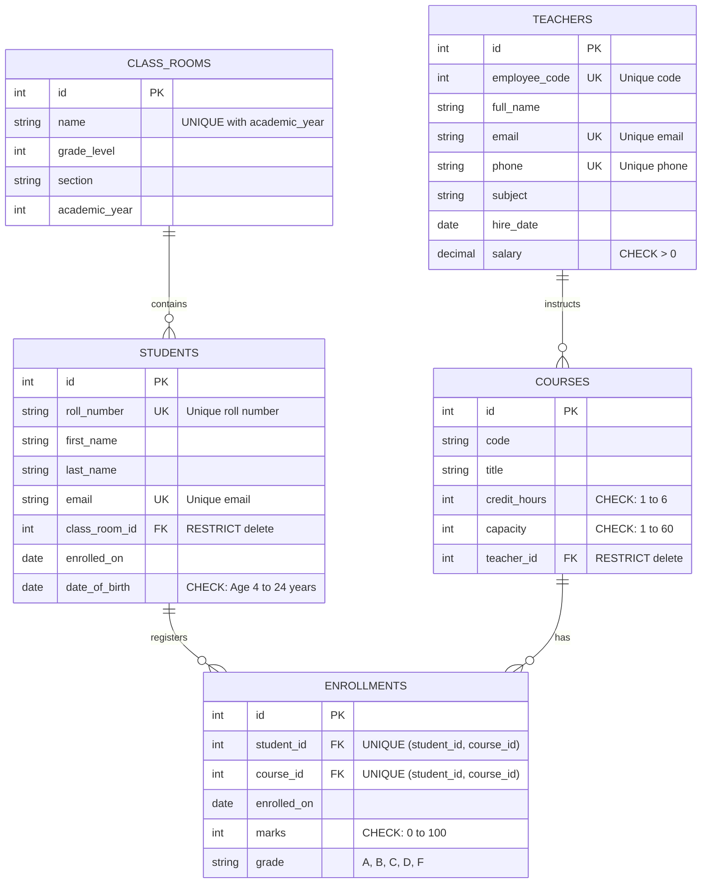

# School Management System API (SchoolApi)

A robust, enterprise-grade School Management REST API built with **ASP.NET Core (.NET 10)**, **PostgreSQL** (via `NpgsqlDataSource` with raw SQL for optimal performance), and tested with **xUnit** and **Postman**.

---

## Table of Contents

- [Overview](#overview)
- [Architecture & Design](#architecture--design)
- [Entity-Relationship (ER) Diagram](#entity-relationship-er-diagram)
- [Core Features](#core-features)
- [Business & Validation Rules](#business--validation-rules)
  - [Enrollment Rules](#enrollment-rules)
  - [Grading Rules](#grading-rules)
  - [Student Age & Uniqueness Rules](#student-age--uniqueness-rules)
  - [Relational Integrity & Foreign Keys](#relational-integrity--foreign-keys)
- [API Endpoints Reference](#api-endpoints-reference)
- [Database Migrations & Seeding](#database-migrations--seeding)
- [Setup & Running Locally](#setup--running-locally)
- [Automated Testing](#automated-testing)
- [Postman Collection](#postman-collection)

---

## Overview

The **SchoolApi** provides a complete backend solution for managing school operations:
- **Classrooms**: Manage grade levels, sections, and academic year allocations.
- **Teachers**: Manage teacher profiles, subject specializations, employee codes, and salaries.
- **Courses**: Offer courses with credit hours (1–6) and enforced seating capacity (1–60).
- **Students**: Student records with roll numbers, age validations (4–24 years), pagination, search, and bulk CSV import.
- **Enrollments & Grading**: Student course enrollment with capacity locking, duplicate enrollment prevention, marks entry (0–100), and automated letter grade calculation.
- **Transcripts & Rosters**: Student GPA transcripts with course breakdowns and course rosters with enrolled student rosters.
- **Reports & Analytics**: Classroom academic toppers and course-level performance statistics (averages, min/max, grade distribution).

---

## Architecture & Design

The application follows a clean, decoupled **Controller-Service-Repository** architectural pattern:

```
[ HTTP Requests ]
       │
       ▼
[ Controllers ]  ──> Input model validation, status codes (200, 400, 404, 409)
       │
       ▼
[ Services ]     ──> Business logic, age & grade calculations, transactions
       │
       ▼
[ Repositories ] ──> Raw SQL queries with parameterized inputs via NpgsqlDataSource
       │
       ▼
[ PostgreSQL DB ]
```

- **Data Access**: Built using native `NpgsqlDataSource` with parameterized SQL commands to guard against SQL injection, ensure transaction control, and maximize performance without ORM overhead.
- **Exception Handling**: Centrally managed with a custom `GlobalExceptionHandler` implementing ASP.NET Core's `IExceptionHandler`, standardizing responses via RFC 7807 `ProblemDetails`.
- **Database Migrations**: Automatic script runner (`DatabaseMigrator`) executes SQL migration files upon application startup in ordinal order.

---

## Entity-Relationship (ER) Diagram



---

## Core Features

1. **Classrooms Management**:
   - Composite uniqueness constraint: A classroom name is unique per academic year (`unique_classroom UNIQUE(name, academic_year)`).
   - Protected deletion: Cannot delete a classroom while students are assigned to it (`ON DELETE RESTRICT`).

2. **Teachers Management**:
   - Enforces unique `employee_code`, `email`, and `phone`.
   - Salary validation: Ensures salary is strictly positive.
   - Protected deletion: Cannot delete a teacher while courses reference them (`ON DELETE RESTRICT`).

3. **Students Management**:
   - Full CRUD operations with search and server-side pagination (`pageSize`, `page`, `classRoomId`, `search`).
   - Age validation: Student date of birth must fall between 4 and 24 years of age.
   - Bulk CSV Import (`POST /api/Students/import`): Ingest multiple student records in a single transactional batch using `CsvHelper`.

4. **Courses Management**:
   - Validates credit hours (1–6) and course capacity (1–60).
   - Generates Course Rosters (`GET /api/Courses/{id}/roster`) listing all enrolled students with marks and grades.

5. **Enrollments & Grading**:
   - Row-level database locking (`FOR UPDATE`) to prevent race conditions when checking course capacity.
   - Prevents duplicate enrollments (`UNIQUE(student_id, course_id)`).
   - Marks updates with boundary validation and automated letter grade calculation.

6. **Transcripts & Analytics**:
   - Student Transcript (`GET /api/Students/{id}/transcript`): Categorizes courses into `CompletedCourses` (with teacher name, course title, marks, and letter grade) and `InProgressCourses`, along with student cumulative average marks (`AvgMarks`).
   - Classroom Toppers (`GET /api/Reports/classrooms/{id}/toppers?limit=3`): Top-ranked students ordered by highest marks.
   - Course Statistics (`GET /api/Reports/courses/{id}/stats`): Average marks, highest marks, lowest marks, and letter grade distribution counts.

---

## Business & Validation Rules

### Enrollment Rules
- **Course Capacity**: When a student enrolls, the course capacity is verified. If the course is full, the transaction rolls back and returns `409 Conflict` (`Capacity Exceeded`).
- **Duplicate Enrollments**: A student cannot enroll in the same course more than once. Attempting to do so returns `409 Conflict` (`Student is already enrolled in the course.`).
- **Referential Integrity**: Course and student must exist before enrollment can occur.

### Grading Rules
Letter grades are computed dynamically upon updating student marks via `GradingRules.CalculateGrade(int marks)`:

| Marks Range | Grade | Description |
| :---: | :---: | :--- |
| **90 – 100** | **A** | Excellent |
| **80 – 89** | **B** | Good |
| **70 – 79** | **C** | Satisfactory |
| **60 – 69** | **D** | Pass |
| **0 – 59** | **F** | Fail |
| **< 0 or > 100** | *Invalid* | Throws `ArgumentException` (`400 Bad Request`) |

### Student Age & Uniqueness Rules
- **Age Window**: A student's age must be between **4 and 24 years** calculated from `date_of_birth`.
- **Unique Roll Number & Email**: Every student must have a unique roll number and email address.

### Relational Integrity & Foreign Keys
- `ON DELETE RESTRICT` is enforced across all foreign keys:
  - Deleting a `Teacher` with active courses fails with `409 Conflict`.
  - Deleting a `ClassRoom` with active students fails with `409 Conflict`.
  - Deleting a `Course` or `Student` with active enrollments is restricted.

---

## API Endpoints Reference

### ClassRooms (`/api/ClassRooms`)
| Method | Endpoint | Description | Status Codes |
| :--- | :--- | :--- | :--- |
| `GET` | `/api/ClassRooms` | Get all classrooms | 200 OK |
| `GET` | `/api/ClassRooms/{id}` | Get classroom by ID | 200 OK, 404 Not Found |
| `POST` | `/api/ClassRooms` | Create new classroom | 200 OK, 400 Bad Request |
| `PUT` | `/api/ClassRooms/{id}` | Update classroom | 200 OK, 404 Not Found |
| `DELETE`| `/api/ClassRooms/{id}` | Delete classroom | 200 OK, 404 Not Found, 409 Conflict |

### Teachers (`/api/Teachers`)
| Method | Endpoint | Description | Status Codes |
| :--- | :--- | :--- | :--- |
| `GET` | `/api/Teachers` | Get all teachers | 200 OK |
| `GET` | `/api/Teachers/{id}` | Get teacher by ID | 200 OK, 404 Not Found |
| `POST` | `/api/Teachers` | Create teacher | 200 OK, 400 Bad Request, 409 Conflict |
| `PUT` | `/api/Teachers/{id}` | Update teacher | 200 OK, 404 Not Found, 409 Conflict |
| `DELETE`| `/api/Teachers/{id}` | Delete teacher | 200 OK, 404 Not Found, 409 Conflict |

### Students (`/api/Students`)
| Method | Endpoint | Description | Status Codes |
| :--- | :--- | :--- | :--- |
| `GET` | `/api/Students` | Get students (supports `pageSize`, `page`, `classRoomId`, `search`) | 200 OK, 400 Bad Request |
| `GET` | `/api/Students/{id}` | Get student by ID | 200 OK, 404 Not Found |
| `POST` | `/api/Students` | Create student | 200 OK, 400 Bad Request, 409 Conflict |
| `PUT` | `/api/Students/{id}` | Update student | 200 OK, 404 Not Found, 409 Conflict |
| `DELETE`| `/api/Students/{id}` | Delete student | 200 OK, 404 Not Found |
| `GET` | `/api/Students/{id}/transcript` | Get student academic transcript | 200 OK, 404 Not Found |
| `POST` | `/api/Students/import` | Bulk import students via multipart CSV file | 200 OK, 500 / Conflict |

### Courses (`/api/Courses`)
| Method | Endpoint | Description | Status Codes |
| :--- | :--- | :--- | :--- |
| `GET` | `/api/Courses` | Get all courses | 200 OK |
| `GET` | `/api/Courses/{id}` | Get course by ID | 200 OK, 404 Not Found |
| `POST` | `/api/Courses` | Create course | 200 OK, 400 Bad Request |
| `PUT` | `/api/Courses/{id}` | Update course | 200 OK, 404 Not Found |
| `DELETE`| `/api/Courses/{id}` | Delete course | 200 OK, 404 Not Found |
| `GET` | `/api/Courses/{id}/roster` | Get course roster with enrolled students | 200 OK, 404 Not Found |

### Enrollments (`/api/Enrollments`)
| Method | Endpoint | Description | Status Codes |
| :--- | :--- | :--- | :--- |
| `POST` | `/api/Enrollments` | Enroll student in course | 200 OK, 400 Bad Request, 409 Conflict |
| `PUT` | `/api/Enrollments/{id}/marks` | Update marks (auto-computes grade) | 200 OK, 400 Bad Request, 404 Not Found |

### Reports (`/api/Reports`)
| Method | Endpoint | Description | Status Codes |
| :--- | :--- | :--- | :--- |
| `GET` | `/api/Reports/classrooms/{id}/toppers?limit=3` | Get top-ranked students in classroom | 200 OK, 400 Bad Request |
| `GET` | `/api/Reports/courses/{id}/stats` | Get course performance statistics | 200 OK, 404 Not Found |

---

## Database Migrations & Seeding

Migrations are located in `SchoolApi/db/Migrations/` and automatically executed upon application startup via `DatabaseMigrator`:

1. `001_create_tables.sql`: Base tables (`class_rooms`, `teachers`, `students`, `courses`, `enrollments`).
2. `002_seed_data.sql`: Seed data for development and initial verification.
3. `003_add_unique_constraint_on_classrooms.sql`: Adds composite uniqueness on classroom `(name, academic_year)`.
4. `004_updated_students_table.sql`: Adds `date_of_birth` column with age boundary check.

---

## Setup & Running Locally

### Prerequisites
- [.NET 10 SDK](https://dotnet.microsoft.com/)
- [PostgreSQL](https://www.postgresql.org/) running locally or in Docker

### Step 1: Create Database & User
Connect to PostgreSQL using `psql` (or pgAdmin) and create the dedicated database user and database:

```bash
# Connect to PostgreSQL as superuser
psql -U postgres
```

Execute the following SQL commands:
```sql
-- Create dedicated database user
CREATE USER school_user WITH PASSWORD 'your_secure_password';

-- Create database owned by the user
CREATE DATABASE school_db OWNER school_user;

-- Grant all privileges on the database
GRANT ALL PRIVILEGES ON DATABASE school_db TO school_user;
```

*(Alternatively, run as a terminal one-liner:)*
```bash
psql -U postgres -c "CREATE USER school_user WITH PASSWORD 'your_secure_password';" \
                -c "CREATE DATABASE school_db OWNER school_user;" \
                -c "GRANT ALL PRIVILEGES ON DATABASE school_db TO school_user;"
```

### Step 2: Configure Connection String via .NET User Secrets
To adhere to the security rule **"never commit the password"**, database credentials must never be placed in `appsettings.json` or committed to version control. `Program.cs` reads the connection string securely through the **.NET Secret Manager** via `builder.Configuration.AddUserSecrets<Program>()`:

```bash
# Navigate to the API project directory
cd SchoolApi

# Store the connection string securely in User Secrets
dotnet user-secrets set "ConnectionStrings:DefaultConnection" "Host=localhost;Port=5432;Database=school_db;Username=school_user;Password=your_secure_password"
```

> [!NOTE]
> `SchoolApi.csproj` has `<UserSecretsId>3dbbb5f8-2d65-436b-a655-794143d5dbc1</UserSecretsId>` pre-configured. User secrets are stored securely outside the source tree in your local user profile directory, keeping sensitive passwords completely out of Git.

### Step 3: Run the Application
```bash
# Start the API (database migrations execute automatically on launch)
dotnet run
```
The application will listen on `http://localhost:5165`.

---

## Automated Testing

Unit tests are located in `SchoolApi.Tests` using **xUnit** and an in-memory fake repository pattern:

- **Enrollment Rules Tests** (`EnrollmentRulesTests.cs`):
  - Valid student enrollment creates record and returns ID.
  - Course capacity overflow triggers `InvalidOperationException("Capacity Exceeded")`.
  - Duplicate enrollment in the same course triggers `InvalidOperationException("Student is already enrolled in the course.")`.
  - Non-existent course or student IDs trigger validation exceptions.
- **Grading Rules Tests** (`GradingRulesTests.cs`):
  - Validates Grade A ($\ge 90$).
  - Validates Grade B ($80–89$).
  - Validates Grade C ($70–79$).
  - Validates Grade D ($60–69$).
  - Validates Grade F ($< 60$).
  - Validates boundary checks for marks $< 0$ or $> 100$ throwing `ArgumentException`.

```bash
# Run unit tests
dotnet test SchoolApi.Tests/SchoolApi.Tests.csproj
```

---

## Postman Collection

A Postman test collection is provided at `SchoolApi/SchoolApi.postman_collection.json`.

### Features Tested in Collection:
1. **ClassRooms**: CRUD, academic year validation, 404 verification, temporary delete.
2. **Teachers**: CRUD, unique constraints (employee code, email, phone), temporary delete.
3. **Students**: CRUD, pagination/search, age validations (`dateOfBirth`), query parameter boundaries (`pageSize < 1`, `page < 1`, `classRoomId < 1`), duplicate checks, and CSV bulk import.
4. **Courses**: CRUD, credit hours range (1–6), capacity range (1–60), temporary delete.
5. **Enrollments**: Happy path, capacity overflow with capacity = 1, duplicate enrollments, update marks boundary checks ($<0$, $>100$), and non-existent IDs.
6. **Transcripts & Rosters**: Student transcripts with grade summary and course rosters.
7. **Reports**: Classroom toppers and course statistics.
8. **Relational Constraints**: Deletion blocks for teachers with courses and classrooms with students.

### Repeat Execution & Pre-Request Scripts
The collection incorporates Postman **pre-request scripts** that dynamically generate unique values (similar to ISBN generation in Day 4) for all constrained columns:
- `teacherEmployeeCode`: Random 6-digit integer (`100000`–`999999`)
- `teacherEmail`: Timestamp-seeded unique email (`teacher.<timestamp>.<rand>@school.edu`)
- `teacherPhone`: Valid 11-digit mobile number (`03<9-random-digits>`)
- `classRoomName`: Random section name (`Grade 10 - Section A <rand>`)
- `studentRollNumber`: Random roll number (`STU-2026-<rand>`)
- `studentEmail`: Timestamp-seeded unique student email

This enables running the entire collection repeatedly in the Postman Collection Runner without facing `409 Conflict` duplicate key errors.

### Sample CSV Import File
A ready-to-use CSV sample is available at `SchoolApi/students_import.csv`:
```csv
RollNumber,FirstName,LastName,Email,ClassRoomId
CSV-101,Harry,Potter,harry.potter.csv@student.school.edu,1
CSV-102,Hermione,Granger,hermione.granger.csv@student.school.edu,1
CSV-103,Ron,Weasley,ron.weasley.csv@student.school.edu,1
```
Use this file in Postman for the `3.12 [Happy Path] Import Students from CSV` request under form-data key `file`.

